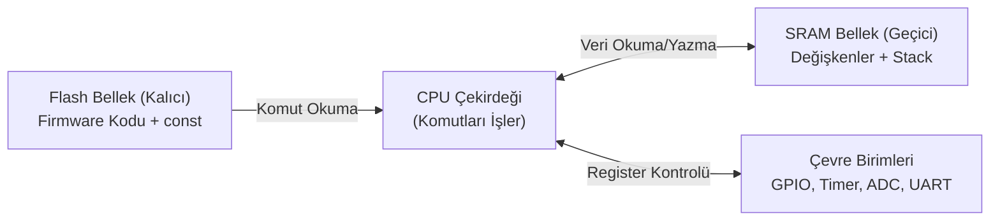

# 7. Konu: Mikrodenetleyici Mimarisi

Bu doküman; MPU vs MCU farkı, CPU, RAM ve Flash bellek mimarisi, GPIO modları (Push-Pull, Open-Drain, AF), Register (Memory-Mapped I/O) mantığı ve Firmware kavramını içerir.

---

## 7.1 MCU vs MPU Farkı ve Temel Bloklar

- **MPU (Microprocessor Unit - Mikroişlemci):** Sadece işlem çekirdeğidir (CPU). Harici RAM, harici Flash ve harici çevre birimleri olmadan tek başına çalışamaz (Bilgisayardaki Intel/AMD işlemciler).
- **MCU (Microcontroller Unit - Mikrodenetleyici):** Tek bir silikon çip içine CPU, RAM, Flash ve çevre birimlerinin (Timer, ADC, GPIO, UART) entegre edildiği tek çipli bilgisayardır (STM32, ESP32, AVR).
- **Temel Donanım Blokları:**
  - **CPU (İşlemci / Çekirdek):** Komutları yürüten beyindir.
  - **Flash Bellek (ROM - Kalıcı / Non-Volatile):** Derlenen program kodunun (Firmware) saklandığı alandır. **Elektrik kesilse dahi silinmez.**
  - **RAM (SRAM - Geçici / Volatile):** Değişkenlerin, dinamik dizilerin ve fonksiyon dönüş adreslerinin (Stack) tutulduğu çalışma masasıdır. **Elektrik kesildiği anda içindeki veriler silinir.**

```text
  MPU (Mikroişlemci - PC / Raspberry Pi)         MCU (Mikrodenetleyici - STM32 / ESP32)
  +---------+     +------------+                 +---------------------------------------+
  |   CPU   |<--->| Harici RAM |                 |              Tek Silikon Çip          |
  +---------+     +------------+                 |  +-------+  +-------+  +-----------+  |
       |          +--------------+               |  |  CPU  |  | Flash |  | RAM (SRAM)|  |
       +--------->| Harici Flash |               |  +---+---+  +---+---+  +-----+-----+  |
       |          +--------------+               |      |          |            |        |
       +--------->| Harici I/O   |               |  ====+==========+============+====Bus |
                  +--------------+               |      |          |            |        |
  (Anakart üzerinde ayrı çipler!)                |  [ GPIO ]   [ Timer ]   [ UART/ADC ]  |
                                                 +---------------------------------------+
```



### Soru - Cevap
> **Soru:**  
> 1) Kod mikrodenetleyiciye yüklendiğinde CPU'ya mı, RAM'e mi, Flash'a mı yazılır?  
> 2) Cihazın elektriği kesilip geldiğinde RAM ve Flash'ın durumu ne olur?  
> **Öğrenci Cevabı:** 1) Flash belleğe kaydedilir. 2) RAM'deki veriler silinir, Flash'taki veriler tutulur kaybolmaz.  
> **Değerlendirme:** Doğru.

---

## 7.2 GPIO (General Purpose Input/Output) ve Modları

- **Giriş Modları:**
  - *Floating:* Boşta kalan, parazite açık mod.
  - *Pull-Up / Pull-Down:* Dahili dirençle pini kararlı $3.3\text{V}$ veya $0\text{V}$ seviyesinde tutan mod.
  - *Analog:* Pini ADC donanımına bağlayan mod.
- **Çıkış Modları:**
  - *Push-Pull:* Pini aktif olarak hem **HIGH ($3.3\text{V}$)** hem **LOW ($0\text{V}$)** yapabilen standart çıkış modudur (LED, röle, motor sürme).
  - *Open-Drain:* Pini sadece **LOW ($0\text{V}$)** yapabilir; HIGH yapabilmek için harici Pull-up direnci gerektirir (I2C haberleşmesi, seviye dönüştürme).
- **Alternatif Fonksiyon (Alternate Function - AF):** Pinin doğrudan Timer (PWM), UART, SPI gibi dahili bir donanıma devredilmesidir.

```text
  1) Push-Pull Çıkış (Aktif 1 & 0):      2) Open-Drain Çıkış (I2C vb.):
     3.3V (VCC)                             3.3V (Harici Pull-Up Direnci)
       |                                      |
    [P-MOS] <-- 1 ise açılır (3.3V)        [4.7kΩ]
       |                                      |
       +--------> Fiziksel Pin                +--------> Fiziksel Pin
       |                                      |
    [N-MOS] <-- 0 ise açılır (0V)          [N-MOS] <-- Sadece GND'ye çeker (0V)
       |                                      |
      GND                                    GND

  3) Alternate Function (AF) Çoklayıcı (MUX):
     GPIO ODR (Yazılımsal 1/0) ──\
     Timer (Donanımsal PWM)    ───[ AF MUX ]===> Fiziksel Pin (PA5)
     UART TX (Seri Haberleşme) ──/
```

### Soru - Cevap
> **Soru:**  
> 1) Bir LED'i $3.3\text{V}$ verip yakmak ve $0\text{V}$ verip söndürmek için hangi çıkış modu seçilmelidir?  
> 2) Pinden bir PWM sinyali üretmek için pin hangi moda alınmalıdır?  
> **Öğrenci Yanıtı:** 1) Push-Pull. 2) Floating sanki $\rightarrow$ Floating'in giriş modu olduğu hatırlatıldı.  
> **Öğrenci Düzeltmesi:** **Alternate Function (AF)**.  
> **Değerlendirme:** Doğru.

---

## 7.3 Yazmaçlar (Registers / Memory-Mapped I/O) ve Firmware

- **Memory-Mapped I/O (Bellek Eşlemeli Giriş/Çıkış):** Mikrodenetleyicilerde donanımlar belirli bellek adreslerine bağlanmıştır. Bu adreslere bit yazmak veya okumak, doğrudan fiziksel dünyayı etkiler.
  - Örneğin `GPIOA->ODR |= (1 << 5);` satırı Port A'nın 5. pinini (PA5) fiziksel olarak $0\text{V}$'tan $3.3\text{V}$'a çıkarır ve bağlı olan LED yanar.
- **Firmware (Bellenim):** Doğrudan mikrodenetleyicinin kalıcı Flash belleğinde barınan, işletim sistemi olmaksızın donanımı yöneten temel alt seviye yazılımdır.

```text
  32-Bit ARM Cortex-M Bellek Haritası (Memory-Mapped I/O):
  +-----------------------------------------+
  | 0x4000 0000 - 0x5FFF FFFF : Peripherals |  --> GPIOA->ODR |= (1 << 5);
  +-----------------------------------------+             |
  | 0x2000 0000 - 0x3FFF FFFF : SRAM (RAM)  |             v
  +-----------------------------------------+      [PA5 Bacağı: 0V -> 3.3V]
  | 0x0800 0000 - 0x0FFF FFFF : Flash (ROM) |             |
  +-----------------------------------------+             v
                                                    (LED YANAR!)
```

### Soru - Cevap
> **Soru:**  
> 1) `GPIOA->ODR |= (1 << 5);` satırı çalıştığında fiziksel bacakta (PA5) ne gerçekleşir?  
> 2) Bir kombi kartındaki koda "Software" yerine neden "Firmware" denir?  
> **Öğrenci Cevabı:** 1) Pin $3.3\text{V}$ olur, LED yanar. 2) Firmware, software'in aksine direkt cihazın kendisini yönetir.  
> **Değerlendirme:** Tamamen doğru.
