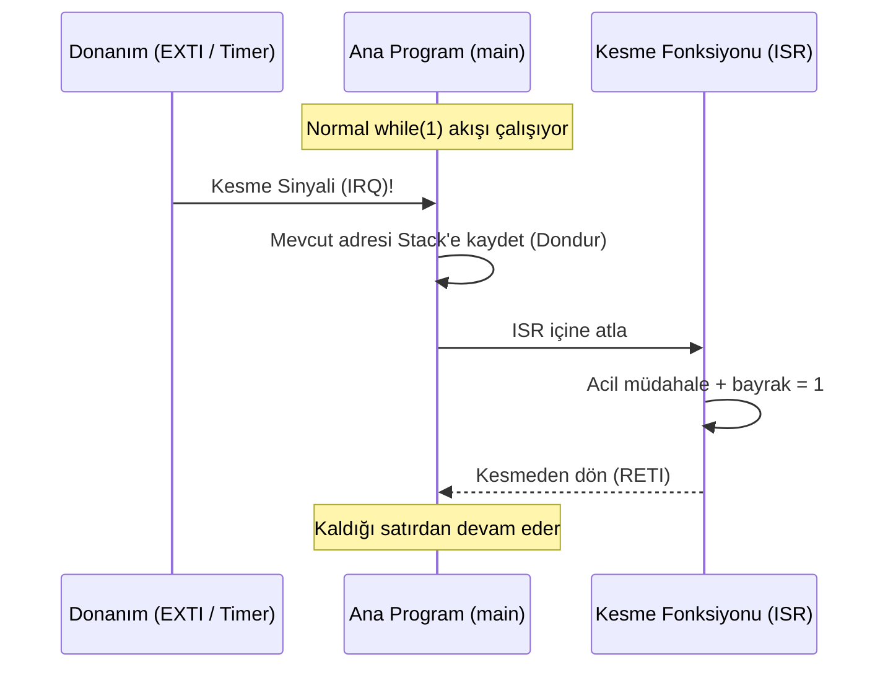
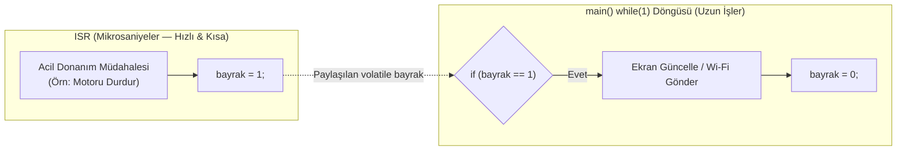

# 10. Konu: Interrupt (Kesme) Mekanizması

Bu doküman; Polling (Sürekli Yoklama) ile Interrupt (Donanımsal Kesme) farkını, ISR (Interrupt Service Routine) yazım kurallarını, Bayrak (Flag) mimarisini, `volatile` anahtar kelimesinin derleyici optimizasyonu üzerindeki etkisini ve gömülü sistemlerde kesme kullanım alanlarını içerir.

---

## 10.1 Polling (Sürekli Yoklama) vs. Interrupt (Kesme)

- **Polling (Sürekli Yoklama):** İşlemcinin `while(1)` döngüsü içinde bir pini veya durumu sürekli kontrol etmesidir.
  - *Dezavantajı:* İşlemci zamanını boşa harcar ve işlemci uzun süren başka bir fonksiyonun içindeyken (örn: ekran çizimi) gelen anlık olayları **kaçırır**.
- **Interrupt (Donanımsal Kesme):** Harici bir pin (EXTI), zamanlayıcı (Timer) veya haberleşme birimi (UART/SPI/I2C) üzerinde bir olay gerçekleştiğinde, donanımın (NVIC) işlemciyi anında uyarmasıdır.
  - İşlemci elindeki işi (`main`) geçici olarak dondurur, **ISR (Kesme Fonksiyonu)** içine gidip acil görevi yapar ve `main` içinde tam kaldığı satırdan çalışmaya devam eder.

```text
  Polling (Sürekli Yoklama):
  main: [Ekran Çizimi (300ms) ........] -> [Buton Oku]  (Anlık sinyal bu arada KAÇTI!)

  Interrupt (Donanımsal Kesme):
  main: [Ekran Çizimi...] --(Kesme!)--+               +--> [Ekran Çizimi Devam...]
                                      |               |
  ISR :                               +-> [Acil Görev]+
```



### Soru - Cevap
> **Soru:** Bir endüstriyel pres makinesinde Lazer Güvenlik Sensörü ile Sıcaklık Göstergesi görevlerinden hangisi Interrupt, hangisi Polling ile yapılmalıdır?  
> **Öğrenci Cevabı:** Lazer için Interrupt yapmak daha iyi olur çünkü acil bir durumda hemen durması gerekir. Sıcaklık için Polling yapmak yeterli olacaktır.  
> **Değerlendirme:** Tamamen doğru.

---

## 10.2 ISR (Interrupt Service Routine) Mantığı ve Altın Kuralları

Kesme oluştuğunda donanımın otomatik olarak çağırdığı özel fonksiyona **ISR (Interrupt Service Routine)** denir (Örn: `EXTI0_IRQHandler`).

### ISR Yazmanın 3 Altın Mühendislik Kuralı
1. **Çok Kısa ve Hızlı Olmalıdır:** ISR çalışırken ana döngü (`main`) ve düşük öncelikli kesmeler durur.
2. **ISR İçinde ASLA `delay` Kullanılmaz:** ISR içinde bekleme yapmak tüm mikrodenetleyiciyi o süre boyunca kilitler (felç eder).
3. **Bayrak (Flag) Mimarisi Kullanılır:** ISR içinde yalnızca acil donanım müdahalesi yapılır ve bir bayrak değişkeni (`bayrak = 1;`) kaldırılır. Uzun süren işlemler (ekran güncelleme, SMS/Wi-Fi gönderimi) `main` döngüsü içinde bu bayrak kontrol edilerek yürütülür.



### Soru - Cevap
> **Soru:**  
> 1) ISR içinde `delay_ms(5000)` ve $3\text{ saniyelik}$ SMS gönderimi yapılmasının hatası nedir?  
> 2) Doğru mimaride (Flag yöntemiyle) işlemler nasıl ayrılmalıdır?  
> **Öğrenci Cevabı:**  
> 1) `delay` ve uzun işlemlerin ISR içerisinde yapılıyor olması hatadır (sistemi kilitler).  
> 2) ISR içinde `bayrak = 1` yapılabilir; SMS gönderme ya da uzun işlemler `main` içerisinde yapılmalıdır.  
> **Değerlendirme:** Tamamen doğru.

---

## 10.3 `volatile` Anahtar Kelimesi ve Kesme Kullanım Alanları

- **Derleyici Optimizasyonu Tuzağı:** Hem ISR içinde değiştirilen hem de `main` içinde okunan bir global değişkenin başına `volatile` yazılmazsa; C derleyicisi `main` döngüsü içinde bu değişkenin değişmediğini varsayarak onu işlemci önbelleğine (CPU Register) alır ve bir daha RAM'e bakmaz. Sonuçta ISR değişkeni RAM'de değiştirse bile `main` bunu asla göremez.
- **`volatile` Çözümü:**
  ```c
  volatile uint8_t veri_geldi_mi = 0;
  ```
  Derleyiciye: *"Bu değişken senin haberin olmadan donanım veya ISR tarafından her an değiştirilebilir; bunu önbelleğe alma, her seferinde doğrudan gerçek RAM adresinden oku!"* emrini verir.

```text
  volatile YOKSA (Optimizasyon Tuzağı):
    ISR  ---> [ RAM: bayrak = 1 ]          main() ---> [ CPU Register: 0 ] (Kördür!)
                                                        (RAM'e hiç bakmaz!)

  volatile VARSA (Doğru Davranış):
    ISR  ---> [ RAM: bayrak = 1 ] <====== Her döngüde RAM'den okur ====== main()
```
- **Temel Kesme Kaynakları:**
  1. **EXTI (Harici Pin Kesmesi):** Acil stop butonları, çarpışma sensörleri, enkoderler.
  2. **Haberleşme Kesmeleri (UART/I2C/SPI RX):** Veri paketi geldiği anda işlemciyi uyandırıp veriyi tampona alma.
  3. **Timer (Zamanlayıcı) Kesmeleri:** Belirli zaman aralıklarında (örn: her $1\text{ ms}$'de bir) periyodik görev çalıştırma.

### Soru - Cevap
> **Soru:** ISR içinde `1` yapılan bayrağın `main` içindeki `if` bloğunda hiç algılanmamasının sebebi ve çözümü nedir?  
> **Öğrenci Cevabı:** Değişkenin başına `volatile` ekleyip derleyiciye *"bu değişkeni önbelleğe alma çünkü senin haberin olmadan değişebilir"* dememiz gerekir.  
> **Değerlendirme:** Kusursuz.

---

## 10.4 Konu Sonu Değerlendirme Testi (Otonom Fabrika Robotu - AGV Senaryosu)

1. **Soru ($300\text{ ms}$ Haritalama Yapan Robotta Çarpışma Sensörü):**
   - **Öğrenci Yanıtı:** Interrupt yapmak daha iyi olur; çünkü Polling hem verimsizdir hem de haritalama işlemi bitmeden cihaz durmaz, bu da robota veya çarptığı yere zarar verir. *(Tam puan)*
2. **Soru (ISR İçinde Motor Kesme ve $2\text{ Saniyelik}$ Wi-Fi Kaza Raporu):**
   - **Öğrenci Yanıtı:** Raporu ISR içinde göndermek kesmeyi gereksiz yere uzatır ve `main` işlemlerini kilitler. Flag kullanarak kaza raporu göndermeyi `main` içerisine taşımamız gerekir. *(Tam puan)*
3. **Soru (`______ uint8_t kaza_bayragi = 0;` Tanımlaması):**
   - **Öğrenci Yanıtı:** `volatile` yazmalıyız; çünkü yazmazsak compiler bu değişkeni önbelleğe alır ve değişken değiştiğinde program bunu anlamaz. *(Tam puan - 3/3 Hatasız)*
