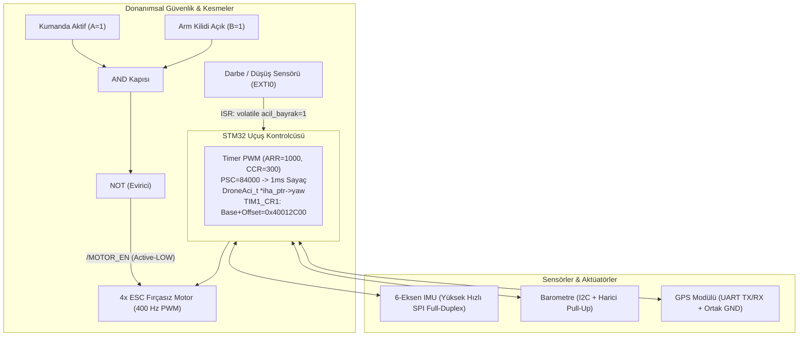

# 1-12. Konular Büyük Final Değerlendirme Sınavı (3. Genel Sınav)

Bu doküman; 1'den 12'ye kadar işlenen tüm temel elektrik-elektronik, sayı sistemleri, lojik kapılar, gömülü C programlama, algoritma, donanım mimarisi, haberleşme protokolleri, pointer/struct, kesmeler, zamanlayıcılar ve debug/datasheet konularının pekiştirilmesi amacıyla gerçekleştirilen Büyük Final Sınavı'nın sorularını, öğrenci yanıtlarını ve detaylı mühendislik analizini içerir.

---

## 📋 Sınav Senaryosu: Otonom İHA (Drone) Uçuş Kontrol Kartı

---

## 1. Soru: Sayı Sistemleri, Lojik Kapılar ve Bit Maskeleme (Konu 1 & 2)
- **Senaryo:** `DRONE_STATUS = 0x96`. Motor izin şartı: Kumanda ($A=1$) VE Kilit Açık ($B=1$). Motor sürücü pini: Active-LOW (`/MOTOR_EN`).
- **Soru:**
  1. `0x96` binary karşılığı ve HIGH olan bitler?
  2. Bit 0'ı Set (`1`), Bit 7'yi Clear (`0`) yapacak C ifadeleri?
  3. Donanımsal güvenlik devresinde hangi lojik kapılar kullanılmalıdır?
- **Öğrenci Yanıtı ve Analiz:**
  1. `1001 0110` $\rightarrow$ Bit 1, 2, 4 ve 7 HIGH. *(Tam puan)*
  2. `DRONE_STATUS |= (1 << 0);` ve `DRONE_STATUS &= ~(1 << 7);` mantığı doğru açıklandı. *(Tam puan)*
  3. İlk aşamada "ya da" yanıtı verildi. OR kapısının herhangi bir giriş $1$ olduğunda da tetikleneceği ve bunun güvenlik zaafı yaratacağı rehberlikle açıklandı. İki şartın da aynı anda sağlanması için **AND (VE)** kapısı, Active-LOW pini $0\text{V}$ ile sürmek için de çıkışa **NOT (Evirici)** kapısı eklenmesi gerektiği kavrandı (NAND mantığı). *(Tam öğrenme doğrulandı)*
- **Değerlendirme:** Tam puan.

---

## 2. Soru: Elektriksel Sinyaller ve Donanımsal Timer/PWM (Konu 3 & 11)
- **Senaryo:** $84\text{ MHz}$ sistem saati, $400\text{ Hz}$ PWM frekansı, $3.3\text{V}$ sinyal seviyesi.
- **Soru:**
  1. $400\text{ Hz}$ PWM periyot süresi ($T$) kaç $\text{ms}$'dir?
  2. $\%30$ Duty Cycle ortalama gerilimi ($V_{\text{ort}}$)?
  3. `ARR = 1000` iken $\%30$ Duty Cycle için `CCR` değeri?
  4. Sayacın $1\text{ ms}$ ($1000\text{ Hz}$) ile sayması için $84\text{ MHz}$ saatte `PSC` kaç olmalıdır?
- **Öğrenci Yanıtı ve Analiz:**
  1. $T = \frac{1}{400} = \mathbf{2.5\text{ ms}}$. *(Tam puan)*
  2. $V_{\text{ort}} = 3.3 \times 0.30 = \mathbf{0.99\text{ V}}$. *(Tam puan)*
  3. $\text{CCR} = 1000 \times 0.30 = \mathbf{300}$. *(Tam puan)*
  4. $\text{PSC} = \frac{84\,000\,000}{1000} = \mathbf{84\,000}$. *(Tam puan)*
- **Değerlendirme:** Tam puan.

---

## 3. Soru: Gömülü C Temelleri, Bellek Mimarisi ve Algoritma (Konu 4, 5, 7)
- **Soru:**
  1. $50\,000\text{ cm}$ irtifa için `uint8_t` kullanılırsa $255$'ten sonra ne olur ve en ideal tip nedir?
  2. `uint16_t motor_rpm[4];` RAM'de kaç bayt tutar ve `motor_rpm[4] = 6000;` yazılırsa ne olur?
  3. `const float` sabiti RAM'de mi Flash'ta mı saklanır?
  4. Karar/koşul yapıları akış şemasında hangi sembolle gösterilir?
- **Öğrenci Yanıtı ve Analiz:**
  1. **Overflow (Taşma)** olur ve $0$'a döner; en az yer kaplayan doğru tip **`uint16_t`**'dir. *(Tam puan)*
  2. $4 \times 2 = \mathbf{8\text{ bayt}}$ yer kaplar. C sınır denetimi yapmaz, dizi dışına yazarak **Bellek Bozulması (Memory Corruption)** oluşturur. *(Tam puan)*
  3. Salt okunur olduğu için **Flash** belleğe yazılır, RAM'i korur. *(Tam puan)*
  4. **Baklava dilimi (Eşkenar dörtgen)**. *(Tam puan)*
- **Değerlendirme:** Tam puan.

---

## 4. Soru: Pointer ve Struct Mimarisi (Konu 9)
- **Soru:**
  1. `3x float` ve `1x uint16_t` içeren `DroneAci_t` struct'ı RAM'de en az kaç bayt yer kaplar?
  2. `iha_ptr` pointer'ı üzerinden `yaw` alanına erişmek için hangi operatör kullanılır?
  3. `&` ve `*` operatörlerinin temel farkı nedir?
  4. Struct'ı fonksiyona doğrudan göndermek yerine pointer ile göndermek RAM ve CPU'ya ne kazandırır?
- **Öğrenci Yanıtı ve Analiz:**
  1. $4 + 4 + 4 + 2 = \mathbf{14\text{ bayt}}$. *(Tam puan)*
  2. İlk aşamada doğrudan değişken üzerinden `iha_durumu.yaw` yazıldı; pointer üzerinden erişimde **`->` (ok operatörü)** kullanılması gerektiği netleştirildi: `iha_ptr->yaw = 180.0f;`. *(Tam puan)*
  3. `&` değişkenin bellek adresini verir, `*` ise o adresteki veriyi okur/yazar. *(Tam puan)*
  4. Değişkenin kopyasını Stack'e çıkarmak yerine yalnızca **4 baytlık adres** aktarılır; RAM ve saat tasarrufu sağlanır. *(Tam puan)*
- **Değerlendirme:** Tam puan.

---

## 5. Soru: Haberleşme Protokolleri (UART, I2C, SPI) (Konu 8)
- **Soru:**
  1. $1\text{ kHz}$ hızlı IMU okuması için neden SPI protokolü tercih edilir?
  2. I2C Open-Drain hatlarına harici Pull-Up bağlanmazsa hat hangi seviyeye çıkamaz?
  3. GPS (UART) bağlantısında TX/RX dışındaki ortak hat nedir ve donanımsal görevi nedir?
  4. 3 köle cihazlı SPI için toplam kaç pin ayrılmalıdır ($3+N$) ve boşta bekleyen CS pinleri hangi seviyede tutulmalıdır?
- **Öğrenci Yanıtı ve Analiz:**
  1. SPI protokolünün çok daha yüksek saat frekanslarına ($\text{MHz}$) çıkabilmesi ve çift yönlü **Full-Duplex** çalışabilmesi sebebiyle tercih edildiği açıklandı. *(Tam puan)*
  2. Hat elektriksel olarak **HIGH ($3.3\text{V}$)** seviyesine çekilemez ve iletişim çöker. *(Tam puan)*
  3. **GND** hattı zorunludur; iki cihazın voltaj seviyelerini ($3.3\text{V} / 0\text{V}$) doğru ölçebilmesi için **$0\text{V}$ ortak referansıdır**. *(Tam puan)*
  4. $3 + 3 = \mathbf{6\text{ pin}}$ gerekir; CS pinleri Active-LOW olduğundan boşta bekleyenler **HIGH** seviyesinde tutulmalıdır. *(Tam puan)*
- **Değerlendirme:** Tam puan.

---

## 6. Soru: Interrupt (Kesme) ve Zamanlama Mimarisi (Konu 10 & 11)
- **Soru:**
  1. Düşüş sensörünü Polling ile sorgulamak yerine donanımsal Interrupt ile yakalamak neden şarttır?
  2. ISR fonksiyonu içine neden `delay` veya `printf` konulamaz?
  3. Bayrak değişkeninde `volatile` unutulursa derleyici optimizasyonu neye yol açar?
  4. $500\text{ ms}$ telemetri gönderiminde bloklamayan kod mantığı nedir?
- **Öğrenci Yanıtı ve Analiz:**
  1. Interrupt anında devreye girerek sıfır gecikmeyle yanıt verir; Polling ise ana döngü sırasını beklediği için gecikmeye ve veri kaybına yol açar. *(Tam puan)*
  2. ISR çalışırken sistemin diğer işleri ve kesmeleri bekletilir; bu yüzden ISR içine bloklayıcı ağır kodlar konulamaz, olabildiğince hızlı sonlanmalıdır. *(Tam puan)*
  3. Derleyici değişkenin değerinin değişmediğini varsayıp RAM'den okumayı bırakır (önbellekler) ve `while` döngüsü kilitlenir. *(Tam puan)*
  4. `delay` işlemciyi hapsedip diğer görevleri durdurur; bloklamayan mimaride `su_anki_zaman - son_zaman >= 500` farkı denetlenerek işlemci serbest bırakılır. *(Tam puan)*
- **Değerlendirme:** Tam puan.

---

## 7. Soru: Debug ve Datasheet / Register Okuma (Konu 12)
- **Soru:**
  1. Fonksiyonun içine girmek için `Step Into` mu `Step Over` mı kullanılır? Diğerine basılırsa ne olur?
  2. Maksimum pin akımı ($I_{IO}$) hangi dokümandadır? Bir pin aynı anda hem PWM hem I2C olabilir mi?
  3. `TIM1_CR1` tablosu (Base: `0x4001 2C00`, Offset: `0x00`, Reset: `0x0000 0000`):
     - Tam fiziksel adres nedir?
     - İlk açılışta sayaç sayar mı?
     - `CEN` (Bit 0) bitini `1` yapmak için hangi operatör kullanılır?
- **Öğrenci Yanıtı ve Analiz:**
  1. `Step Into` içine dalar; `Step Over` fonksiyonu tek hamlede çalıştırıp bir alt satır olan `motoru_sur()` üzerinde durur. *(Tam puan)*
  2. Akım sınırı **Datasheet**'tedir. Dahili çoklama nedeniyle bir pin aynı anda yalnızca 1 fonksiyonda çalışabilir. *(Tam puan)*
  3. Adres: $\text{Base} + \text{Offset} = \mathbf{\text{0x4001 2C00}}$. Reset değeri `0` olduğu için sayaç **durur**. Biti `1` yapmak için **Bitwise OR (`|=`)** kullanılır. *(Tam puan)*
- **Değerlendirme:** Tam puan.

---

## 🏆 Sınav Sonucu ve Genel Başarı Değerlendirmesi

- **Toplam Soru Sayısı:** 7 Temel Senaryo Sorusu (Tüm müfredat - Konu 1-12)
- **Başarı Oranı:** $\%100$ (Tüm kavramlar, hesaplamalar ve hata analizleri eksiksiz tamamlandı)
- **Yetkinlik Özeti:**
  - Sayı sistemleri, bit manipülasyonu ve lojik devre tasarımları tam kavrandı.
  - Donanımsal Timer (PSC, CNT, ARR, CCR) ve PWM dinamiği hatasız hesaplandı.
  - Gömülü C bellek yönetimi (RAM, Flash, Overflow, Pointer, Struct) eksiksiz uygulandı.
  - UART, I2C ve SPI protokollerinin donanımsal ve elektriksel kuralları tam öğrenildi.
  - Kesme (ISR), `volatile` ve bloklamayan mimariler kavrandı.
  - Donanımsal Debugger (SWD), Stepping mekanizmaları, Datasheet vs Reference Manual ayrımı ve yazmaç ofset/bit işlemleri başarıyla tamamlandı.
