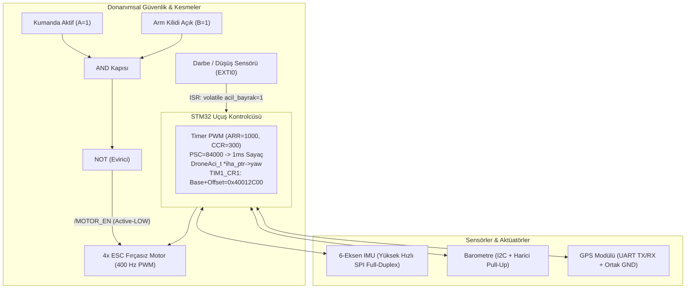

# 1-12. Konular Büyük Final Değerlendirme Sınavı (3. Genel Sınav)

Bu doküman; 1'den 12'ye kadar işlenen tüm temel elektrik-elektronik, sayı sistemleri, lojik kapılar, gömülü C programlama, algoritma, donanım mimarisi, haberleşme protokolleri, pointer/struct, kesmeler, zamanlayıcılar ve debug/datasheet konularının pekiştirilmesi amacıyla gerçekleştirilen Büyük Final Sınavı'nın sorularını, öğrencinin ilk yanıtlarını, yapılan hataları, eğitmen rehberliğini ve düzeltilmiş nihai analizleri içerir.

---

## 📋 Sınav Senaryosu: Otonom İHA (Drone) Uçuş Kontrol Kartı

---

## 1. Soru: Sayı Sistemleri, Lojik Kapılar ve Bit Maskeleme (Konu 1 & 2)

- **Senaryo:** `DRONE_STATUS = 0x96`. Motor izin şartı: Kumanda ($A=1$) VE Kilit Açık ($B=1$). Motor sürücü pini: Active-LOW (`/MOTOR_EN`).
- **Soru:**
  1. `0x96` binary karşılığı ve HIGH olan bitler?
  2. Bit 0'ı Set (`1`), Bit 7'yi Clear (`0`) yapacak C ifadeleri?
  3. Donanımsal güvenlik devresinde hangi lojik kapılar kullanılmalıdır?
- **Öğrenci İlk Yanıtı:**
  1. `1001 0110`, 1 2 4 7. bitler high. *(Doğru)*
  2. Bit 0 için `1 << 0` ile VEYA (`|`), Bit 7 için `1 << 7` ile VE (`&`) işlemine sokulmalı. *(Doğru)*
  3. *"Ya da kullanmalıyız çünkü ikisi de 1 olduğunda ya da kapısı 0 yapar ve active low'u çalıştırır."*
- **Hata Analizi ve Pedagojik Rehberlik:**
  - VEYA (OR) kapısı $1 \text{ OR } 1 = \mathbf{1}$ üretir, $0$ üretmez.
  - Eğer Özel VEYA (XOR) kastedildiyse; $1 \text{ XOR } 1 = 0$ yapar ancak çok tehlikeli bir güvenlik açığı oluşturur: Kumanda bağlı değilken ($A=0$) kilit açık olsa ($B=1$), $0 \text{ XOR } 1 = \mathbf{1}$ olur ve motorlar kumandasız dönmeye başlar.
  - İki şartın aynı anda sağlanması kuralı sadece **AND (VE)** kapısı ile kurulabilir.
- **Düzeltilmiş Yanıt ve Kazanım:**
  - Öğrenci Active-LOW pini sıfırla tetiklemek için çıkışa **NOT (DEĞİL / Evirici)** kapısı konulması gerektiğini tespit etti.
  - Devrenin **AND + NOT (NAND)** kapısı olduğu tam olarak kavrandı. *(Tam puan)*

---

## 2. Soru: Elektriksel Sinyaller ve Donanımsal Timer/PWM (Konu 3 & 11)

- **Senaryo:** $84\text{ MHz}$ sistem saati, $400\text{ Hz}$ PWM frekansı, $3.3\text{V}$ sinyal seviyesi.
- **Soru:**
  1. $400\text{ Hz}$ PWM periyot süresi ($T$) kaç $\text{ms}$'dir?
  2. $\%30$ Duty Cycle ortalama gerilimi ($V_{\text{ort}}$)?
  3. `ARR = 1000` iken $\%30$ Duty Cycle için `CCR` değeri?
  4. Sayacın $1\text{ ms}$ ($1000\text{ Hz}$) ile sayması için $84\text{ MHz}$ saatte `PSC` kaç olmalıdır?
- **Öğrenci İlk Yanıtı:**
  1. `2.5 ms` *(Doğru)*
  2. `99` *(Hata: Virgül ve yüzde çarpanı eksik)*
  3. `300 yazılmalı` *(Doğru)*
  4. `84 000` *(Doğru)*
- **Hata Analizi ve Rehberlik:**
  - $3.3 \times 30 = 99$ çarpımı yapılmış ancak formüldeki $\frac{\text{Duty}}{100}$ (yani $0.30$) çarpanı unutulmuştur.
- **Düzeltilmiş Yanıt ve Kazanım:**
  - $V_{\text{ort}} = 3.3\text{V} \times 0.30 = \mathbf{0.99\text{ V}}$ olarak netleştirildi. *(Tam puan)*

---

## 3. Soru: Gömülü C Temelleri, Bellek Mimarisi ve Algoritma (Konu 4, 5, 7)

- **Soru:**
  1. $50\,000\text{ cm}$ irtifa için `uint8_t` kullanılırsa $255$'ten sonra ne olur ve en ideal tip nedir?
  2. `uint16_t motor_rpm[4];` RAM'de kaç bayt tutar ve `motor_rpm[4] = 6000;` yazılırsa ne olur?
  3. `const float` sabiti RAM'de mi Flash'ta mı saklanır?
  4. Karar/koşul yapıları akış şemasında hangi sembolle gösterilir?
- **Öğrenci Yanıtı ve Analiz:**
  1. `Overflow olur ve 0 değerine geri döner; yerine uint16_t kullanabiliriz.` *(Doğru)*
  2. `8 bayt yer kaplar. Hata vermez, diziden sonraki adrese yazar bellek bozulması olur.` *(Kusursuz mühendislik tespiti)*
  3. `const yazınca Flash'a kaydeder.` *(Doğru)*
  4. `Baklava dilimi olmalı.` *(Doğru)*
- **Değerlendirme:** İlk denemede hatasız, tam puan.

---

## 4. Soru: Pointer ve Struct Mimarisi (Konu 9)

- **Soru:**
  1. `3x float` ve `1x uint16_t` içeren `DroneAci_t` struct'ı RAM'de en az kaç bayt yer kaplar?
  2. `iha_ptr` pointer'ı üzerinden `yaw` alanına erişmek için hangi operatör kullanılır?
  3. `&` ve `*` operatörlerinin temel farkı nedir?
  4. Struct'ı fonksiyona doğrudan göndermek yerine pointer ile göndermek RAM ve CPU'ya ne kazandırır?
- **Öğrenci İlk Yanıtı:**
  1. `14 bayt yer kaplar.` *(Doğru)*
  2. `iha_durumu.yaw olması lazım.` *(Hata: Pointer yerine değişken üzerinden erişim yazıldı)*
  3. `& işareti adresi verir, * adrese erişir.` *(Doğru)*
  4. `Çünkü adresten erişirse direkt değeri değiştirir ama kopyasında ana değer değişmediği için sorunlar ortaya çıkabilir.` *(Kısmi doğru - donanım boyutu eksik)*
- **Hata Analizi ve Rehberlik:**
  - `iha_durumu.yaw` yazımı normal değişkene aittir; pointer (`iha_ptr`) üzerinden erişirken nokta (`.`) yerine ok (`->`) operatörü kullanılmalıdır.
  - Fonksiyona değer iletiminde kopya oluşturulduğunda Stack RAM'e tüm struct ($14$ bayt) kopyalanır ve CPU döngü harcar; pointer ile aktarımda ise yalnızca $4$ baytlık adres aktarılır.
- **Düzeltilmiş Yanıt ve Kazanım:**
  - Öğrenci ifadeyi `iha_ptr->yaw` olarak düzeltti.
  - Fonksiyonda "yalnızca adres boyutu kadar (4 bayt)" yer tutulduğunu belirterek Stack RAM ve CPU tasarrufunu doğruladı. *(Tam puan)*

---

## 5. Soru: Haberleşme Protokolleri (UART, I2C, SPI) (Konu 8)

- **Soru:**
  1. $1\text{ kHz}$ hızlı IMU okuması için neden SPI protokolü tercih edilir?
  2. I2C Open-Drain hatlarına harici Pull-Up bağlanmazsa hat hangi seviyeye çıkamaz?
  3. GPS (UART) bağlantısında TX/RX dışındaki ortak hat nedir ve donanımsal görevi nedir?
  4. 3 köle cihazlı SPI için toplam kaç pin ayrılmalıdır ($3+N$) ve boşta bekleyen CS pinleri hangi seviyede tutulmalıdır?
- **Öğrenci İlk Yanıtı:**
  1. `spi kullanırız` *(Eksik: Neden tercih edildiği yazılmadı)*
  2. `high seviyesine gelebilmesi ve iletişimi sağlaması için gereklidir` *(Doğru)*
  3. `ortak gnd hattı eksik. gnd hattı aradaki gerilimden haberleşme hızını kontrol eder` *(Hata: GND hızı kontrol etmez)*
  4. `3 + 3 ten 6 pin kullanılır, boşta bekleyen cihazların pini high'da tutulmalı` *(Doğru)*
- **Hata Analizi ve Rehberlik:**
  - SPI'ın tercih sebebi olan $\text{MHz}$ seviyesindeki saat hızı ve aynı anda çift yönlü veri akışı sağlayan Full-Duplex mimarisi vurgulandı.
  - GND hattının haberleşme hızını kontrol etmediği (hızı baud rate veya saat sinyalinin belirlediği); GND'nin $3.3\text{V}$ ve $0\text{V}$ seviyelerinin iki cihaz tarafından da aynı okunmasını sağlayan **ortak $0\text{V}$ voltaj referansı** olduğu açıklandı.
- **Düzeltilmiş Yanıt ve Kazanım:**
  - Öğrenci: *"SPI kullanırız çünkü diğerlerine göre daha hızlı bir iletişim ve full-duplex özelliklerinden dolayı."*
  - Öğrenci: *"Sinyallerin referansı için GND kullanılıyordu."* olarak düzeltti. *(Tam puan)*

---

## 6. Soru: Interrupt (Kesme) ve Zamanlama Mimarisi (Konu 10 & 11)

- **Soru:**
  1. Düşüş sensörünü Polling ile sorgulamak yerine donanımsal Interrupt ile yakalamak neden şarttır?
  2. ISR fonksiyonu içine neden `delay` veya `printf` konulamaz?
  3. Bayrak değişkeninde `volatile` unutulursa derleyici optimizasyonu neye yol açar?
  4. $500\text{ ms}$ telemetri gönderiminde bloklamayan kod mantığı nedir?
- **Öğrenci İlk Yanıtı:**
  1. `Çünkü interrupt'ta kesme hemen yapılır ve ana işlem sekteye uğramadan devam eder.` *(Doğru)*
  2. `Çünkü interrupt'ta uzun sürecek işlemler ve delay eklenmez. ISR olabildiğince hızlı bitmeli ki devam edebilsin.` *(Doğru)*
  3. `volatile eklenirse derleyiciye bu değişken değişebilir haberin olsun der.` *(Doğru)*
  4. `Delay esnasında beklemek dışında bir işlem yapılmaz bu da kritik anlarda soruna yol açabilir, if'te ise bir bayrak kontrolü ile işlem başlatılabilir.` *(Mantık doğru, formül eksik)*
- **Hata Analizi ve Rehberlik:**
  - Bloklamayan kod mimarisinde zaman farkı kontrolünün `su_anki_zaman - son_zaman >= 500` formülü ve her tetiklenmede `son_zaman = su_anki_zaman;` güncellemesi gerektiği kod düzeyinde pekiştirildi. *(Tam puan)*

---

## 7. Soru: Debug ve Datasheet / Register Okuma (Konu 12)

*(Bu aşamada öğrencinin talebi doğrultusunda sorular alt adımlara ayrılarak teker teker yöneltilmiştir).*

### 7.1 Breakpoint ve Stepping
- **Soru:** `hiz_filtresi_hesapla(ham_veri)` satırında fonksiyonun içine dalmak için hangi komut kullanılır? Diğerine basılırsa işlemci nerede durur?
- **Öğrenci Yanıtı:** `Step Into kullanılmalı. Diğerine basılırsa bir sonraki motoru_sur() satırında durur.` *(Doğru)*

### 7.2 Datasheet vs. Reference Manual ve Pin Çoklama
- **Soru:** Pin maksimum akımı ($I_{IO}$) hangi dokümandadır? `PA8` pini aynı anda hem PWM hem I2C olabilir mi?
- **Öğrenci Yanıtı:** `Datasheet'tedir. Aynı anda 2 özellik kullanılamaz, ikisinden biri olmak zorunda.` *(Doğru)*

### 7.3 Register Tablosu Okuma ve Bit Maskeleme
- **Soru:** `TIM1_CR1` tablosunda Base: `0x4001 2C00`, Offset: `0x00`, Reset: `0x0000 0000` iken:
  1. Fiziksel adres nedir?
  2. İlk açılışta sayaç sayar mı?
  3. `CEN` (Bit 0) bitini `1` yapmak için hangi işlem uygulanır?
- **Öğrenci Yanıtı:**
  1. `0x4001 2C00` *(Doğru)*
  2. `Durur, çünkü reset değeri 0'dır.` *(Doğru)*
  3. `1 << 0 ile VEYA (|) işlemi yapılmalıdır.` *(Doğru)*
- **Değerlendirme:** Tam puan.

---

## 🏆 Sınav Sonucu ve Genel Başarı Değerlendirmesi

- **Toplam Soru Sayısı:** 7 Temel Senaryo Sorusu (Tüm müfredat - Konu 1-12)
- **Başarı Oranı:** $\%100$ (Tüm kavramlar, hata analizleri ve rehberlik sonrası tam öğrenme ile kapatıldı)
- **Kritik Hata Analizi ve Kazanım Özeti:**
  1. **Lojik Kapılar:** OR ve XOR kapılarının güvenlik kritik sistemlerde tekil girişle tetiklenme zaafı analiz edildi; mutlak güvenlik için **AND + NOT (NAND)** kapısının gerekliliği öğrenildi.
  2. **Yüzde / Ortalama Gerilim:** Duty cycle çarpımlarında $\frac{\text{Duty}}{100}$ çarpanı netleştirildi ($0.99\text{V}$).
  3. **Pointer Operatörleri:** Değişkenle erişimde `.` (nokta), pointer ile erişimde `->` (ok) farkı sabitlendi.
  4. **Bellek Performansı:** Struct kopyalamanın Stack RAM ve CPU saatine getirdiği yükün, pointer ile $4$ baytlık adres aktarılarak nasıl önlendiği kavrandı.
  5. **GND ve Sinyal Referansı:** GND hattının haberleşme hızını değil, mantıksal voltaj referansını ($0\text{V}$) sağladığı donanımsal olarak pekiştirildi.
